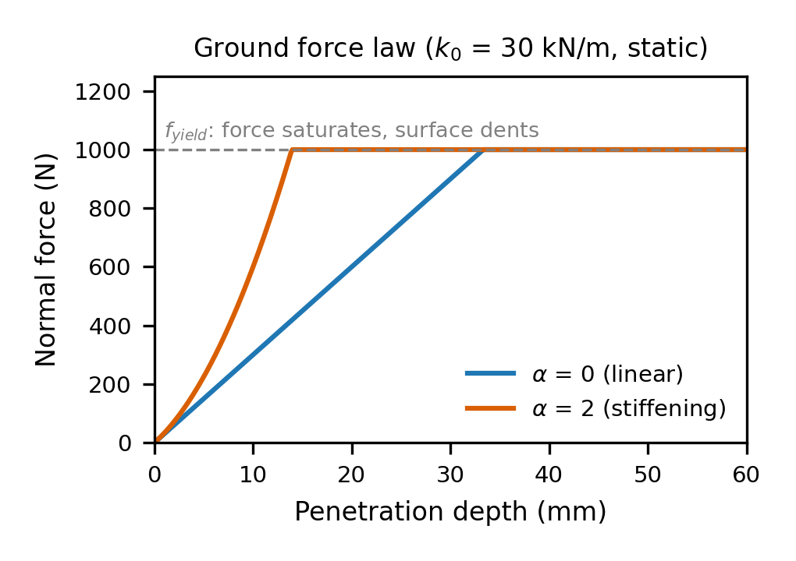

### Ground Model (`ground.py`): Design and Evolution

**Purpose.** MuJoCo's own floor contact is switched off, so `GroundModel` supplies the contact force at the heel and toe. A new ground (stiffness, damping, yield strength, friction) is drawn each episode, and the test ranges do not overlap the train ranges, so the agent must generalise rather than memorise one surface.

**Force law.** Normal force is a depth-stiffening spring plus a damper, `F = k0(1 + αd/D_ref)·d + c·ḋ`, clamped at zero since ground cannot pull. Past a yield force `f_yield` the force saturates and the surface is permanently dented (Fig. 1). Friction is Coulomb friction smoothed with `tanh(v/ε)`, which avoids the sign flip that causes jitter under an explicit integrator. The force law is kept free of MuJoCo so unit tests can check it against hand calculations.

**Evolution.**
1. *Damping as a ratio.* Damping was first drawn as a raw coefficient `c`, independent of stiffness. It is now drawn as a damping ratio ζ and converted with `c = 2ζ√(k0·m)`, so it scales with the stiffness drawn. The mass `m` was first hard-coded and is now read from the loaded MuJoCo model.
2. *Sourced ranges.* Parameter ranges were traced to published values (e.g. Bekker sinkage data for sand, α: 0–15 → 0–2). Unit conversions are documented in `Reports/Justifications/JUSTIFICATION-ground.md`.
3. *Visual deformation.* With MuJoCo's floor off, the foot would appear to sink into empty air. A strip of small ground-cell boxes is lowered under the foot and keeps its deepest dent, so the trench remains after lift-off.
4. *Shared material.* Heel and toe now share one material per episode (previously independent), which is more consistent with a single patch of ground.
5. *Damping cap.* At the 0.5 ms timestep, a large `c` on the light (~0.6 kg) heel contact can overshoot in the explicit damping step and cause bouncing, so `c` is capped at `0.75·m_heel/Δt`. Yield ranges were also shifted (train 610–3000 N, test 400–590 N).

**Challenges.** (i) Fast sinking can make the damping term alone exceed `f_yield` while the spring is shallow, which produced a negative dent (the ground rose). The dent is now floored at zero. (ii) Published data comes in different forms (surface stiffness under an athlete, subgrade modulus, energy return), so each needed its own conversion, and some test-range values (soft ground, α) have no source and are design choices.

**Limitations.** The model has two independent contact points with no heel–toe load spreading and no rate-dependent behaviour. Damping derived from drop tests likely overstates real energy loss, and the 0.75 cap factor was chosen empirically.
